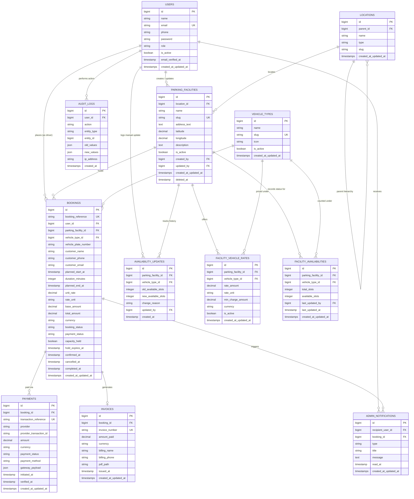

# Parkly — Database Schema Design

**Document:** `DATABASE_SCHEMA.md`  
**Product:** Parkly: An AI-Powered Parking Discovery and Booking Platform  
**Target RDBMS:** MySQL / MariaDB (Tested on local MariaDB 10.4.32 / Laravel 12)  
**Status:** Proposed Architecture & Schema Baseline (Draft for Team Approval)  
**Companion Documents:** [`Parkly_PRD.md`](file:///d:/parkly-parking-platform/Parkly_PRD.md), [`TRD.md`](file:///d:/parkly-parking-platform/TRD.md), [`APP_FLOW.md`](file:///d:/parkly-parking-platform/APP_FLOW.md)

---

## 1. Executive Summary & Design Principles

The Parkly database schema is designed according to the authoritative requirements set out in the PRD, TRD, and Application Flow documents.

### Key Architectural Tenets:
1. **Registered Facilities are the Sole Source of Inventory:** Only facilities explicitly registered in `parking_facilities` can be searched or booked. Google Maps is strictly a visual and geographic assistance layer, not an inventory or capacity store.
2. **Server-Side Financial & Capacity Authority:** The frontend never submits or dictates a price or slot count. All rate calculation, duration verification, slot availability decrements, and payment status checks are verified transactionally by Laravel.
3. **Monetary Precision:** All currency amounts use `DECIMAL(10, 2)` with currency defaulting to `BDT`. No floating-point types (`FLOAT`, `DOUBLE`) are used for monetary calculation.
4. **Coordinate Integrity:** Latitude and Longitude are stored as `DECIMAL(10, 7)` and `DECIMAL(10, 7)` allowing sub-meter geographic precision while remaining completely portable across MariaDB/MySQL without proprietary spatial extensions.
5. **Immutable Historical Records:** Modifying a facility's future rate or address does not alter past or active bookings or invoices. Every confirmed booking maintains an immutable snapshot of rates, vehicle compatibility, and pricing breakdowns.
6. **Concurrency & Overbooking Prevention:** Booking transactions utilize database row-level locking (`SELECT ... FOR UPDATE`) or atomic decrements on `facility_availabilities` to eliminate race conditions.

---

## 2. Entity Relationship (ER) Diagram



---

## 3. Detailed Table Specifications

### 3.1 `users` (Authentication & Access Control)
- **Purpose:** Stores system administrators, parking operators (if enabled), and registered drivers.
- **Notes on Scope:** Laravel 12 already provides a baseline `users` table. We add `role`, `phone`, and `is_active` fields.
- **Columns:**

| Column | Type | Attributes | Description / Integrity Rules |
|---|---|---|---|
| `id` | `BIGINT UNSIGNED` | `AUTO_INCREMENT`, PK | Unique user identifier. |
| `name` | `VARCHAR(255)` | `NOT NULL` | Full name of the user. |
| `email` | `VARCHAR(255)` | `NOT NULL`, `UNIQUE` | User email address for credentials and communication. |
| `phone` | `VARCHAR(32)` | `NULLABLE` | Contact phone number for SMS or driver confirmation. |
| `password` | `VARCHAR(255)` | `NOT NULL` | Hashed password (Bcrypt/Argon2). |
| `role` | `VARCHAR(32)` | `NOT NULL`, Default: `'driver'` | Roles: `admin`, `operator`, `driver`. Indexed. |
| `is_active` | `TINYINT(1)` | `NOT NULL`, Default: `1` | Controls whether account can authenticate. |
| `email_verified_at` | `TIMESTAMP` | `NULLABLE` | Email verification date. |
| `remember_token` | `VARCHAR(100)` | `NULLABLE` | Laravel remember token. |
| `created_at`, `updated_at`| `TIMESTAMP` | `NULLABLE` | Standard audit timestamps. |

- **Indexes:**
  - `PRIMARY KEY (id)`
  - `UNIQUE KEY users_email_unique (email)`
  - `INDEX users_role_index (role)`
  - `INDEX users_is_active_index (is_active)`

---

### 3.2 `locations` (Administrative Hierarchy)
- **Purpose:** Normalizes the hierarchical location selector: **Division → District → Thana/Upazila → Area** for manual search filtering as required in PRD §5.1 and APP_FLOW §6.3.
- **Columns:**

| Column | Type | Attributes | Description / Integrity Rules |
|---|---|---|---|
| `id` | `BIGINT UNSIGNED` | `AUTO_INCREMENT`, PK | Unique location identifier. |
| `parent_id` | `BIGINT UNSIGNED` | `NULLABLE`, FK | Self-referencing FK pointing to higher administrative level. `ON DELETE RESTRICT`. |
| `name` | `VARCHAR(128)` | `NOT NULL` | Name in English (e.g., `'Dhaka'`, `'Mirpur'`). |
| `type` | `VARCHAR(32)` | `NOT NULL` | Enum/string: `'division'`, `'district'`, `'thana'`, `'area'`. |
| `slug` | `VARCHAR(128)` | `NOT NULL` | URL/query safe slug. |
| `created_at`, `updated_at`| `TIMESTAMP` | `NULLABLE` | Standard audit timestamps. |

- **Indexes & Foreign Keys:**
  - `PRIMARY KEY (id)`
  - `FOREIGN KEY (parent_id) REFERENCES locations(id) ON DELETE RESTRICT`
  - `UNIQUE KEY locations_parent_slug_unique (parent_id, slug)`
  - `INDEX locations_parent_id_type_idx (parent_id, type)`
  - `INDEX locations_slug_idx (slug)`

---

### 3.3 `parking_facilities` (Registered Parking Inventory)
- **Purpose:** Master catalog of registered physical parking locations. Only facilities in this table can appear in searches or accept bookings.
- **Columns:**

| Column | Type | Attributes | Description / Integrity Rules |
|---|---|---|---|
| `id` | `BIGINT UNSIGNED` | `AUTO_INCREMENT`, PK | Unique facility identifier. |
| `location_id` | `BIGINT UNSIGNED` | `NULLABLE`, FK | Links to lowest matching `locations` node. `ON DELETE SET NULL`. |
| `name` | `VARCHAR(255)` | `NOT NULL` | Name of facility (e.g. "Bashundhara City Parking"). |
| `slug` | `VARCHAR(255)` | `NOT NULL`, `UNIQUE` | Unique slug for SEO and routing. |
| `address_text` | `TEXT` | `NOT NULL` | Human-readable postal or street address. |
| `latitude` | `DECIMAL(10, 7)` | `NOT NULL` | WGS-84 Latitude between -90.0 and 90.0. |
| `longitude` | `DECIMAL(10, 7)` | `NOT NULL` | WGS-84 Longitude between -180.0 and 180.0. |
| `description` | `TEXT` | `NULLABLE` | Operational details, amenities (CCTV, covered, height clearance). |
| `is_active` | `TINYINT(1)` | `NOT NULL`, Default: `1` | Inactive facilities are excluded from public search and booking. |
| `created_by` | `BIGINT UNSIGNED` | `NULLABLE`, FK | Admin user who registered the facility. `ON DELETE SET NULL`. |
| `updated_by` | `BIGINT UNSIGNED` | `NULLABLE`, FK | Admin user who last modified it. `ON DELETE SET NULL`. |
| `created_at`, `updated_at`| `TIMESTAMP` | `NULLABLE` | Standard audit timestamps. |
| `deleted_at` | `TIMESTAMP` | `NULLABLE` | Soft-delete timestamp to preserve past booking histories. |

- **Indexes & Foreign Keys:**
  - `PRIMARY KEY (id)`
  - `UNIQUE KEY facilities_slug_unique (slug)`
  - `FOREIGN KEY (location_id) REFERENCES locations(id) ON DELETE SET NULL`
  - `FOREIGN KEY (created_by) REFERENCES users(id) ON DELETE SET NULL`
  - `FOREIGN KEY (updated_by) REFERENCES users(id) ON DELETE SET NULL`
  - `INDEX facilities_search_coords_idx (is_active, latitude, longitude)`
  - `INDEX facilities_location_idx (location_id, is_active)`

---

### 3.4 `vehicle_types` (Supported Categories)
- **Purpose:** Canonical categories of vehicles supported across the platform (e.g. Car / Sedan / SUV, Motorcycle, Bicycle, Microbus).
- **Columns:**

| Column | Type | Attributes | Description / Integrity Rules |
|---|---|---|---|
| `id` | `BIGINT UNSIGNED` | `AUTO_INCREMENT`, PK | Unique vehicle type identifier. |
| `name` | `VARCHAR(64)` | `NOT NULL` | Display title (e.g., `'Car / Sedan'`, `'Motorcycle'`). |
| `slug` | `VARCHAR(64)` | `NOT NULL`, `UNIQUE` | Identifier matching Gemini extraction (`'car'`, `'motorcycle'`). |
| `icon` | `VARCHAR(64)` | `NULLABLE` | Frontend icon identifier. |
| `is_active` | `TINYINT(1)` | `NOT NULL`, Default: `1` | Controls whether vehicle category is selectable. |
| `created_at`, `updated_at`| `TIMESTAMP` | `NULLABLE` | Standard audit timestamps. |

- **Indexes:**
  - `PRIMARY KEY (id)`
  - `UNIQUE KEY vehicle_types_slug_unique (slug)`
  - `INDEX vehicle_types_is_active_idx (is_active)`

---

### 3.5 `facility_vehicle_rates` (Pricing Matrix)
- **Purpose:** Maps facilities to allowed vehicle types, defining unit rates and minimum charges.
- **Columns:**

| Column | Type | Attributes | Description / Integrity Rules |
|---|---|---|---|
| `id` | `BIGINT UNSIGNED` | `AUTO_INCREMENT`, PK | Unique rate row identifier. |
| `parking_facility_id` | `BIGINT UNSIGNED` | `NOT NULL`, FK | Reference to `parking_facilities(id)`. `ON DELETE CASCADE`. |
| `vehicle_type_id` | `BIGINT UNSIGNED` | `NOT NULL`, FK | Reference to `vehicle_types(id)`. `ON DELETE RESTRICT`. |
| `rate_amount` | `DECIMAL(10, 2)` | `NOT NULL` | Price per rate unit (e.g. 50.00). Must be `>= 0.00`. |
| `rate_unit` | `VARCHAR(32)` | `NOT NULL`, Default: `'hour'` | Unit of rate (`'hour'`, `'day'`). |
| `min_charge_amount` | `DECIMAL(10, 2)` | `NOT NULL`, Default: `0.00` | Minimum charge applied if duration is short. |
| `currency` | `VARCHAR(3)` | `NOT NULL`, Default: `'BDT'` | Currency code (ISO 4217). |
| `is_active` | `TINYINT(1)` | `NOT NULL`, Default: `1` | Controls if this rate combination is currently bookable. |
| `created_at`, `updated_at`| `TIMESTAMP` | `NULLABLE` | Standard audit timestamps. |

- **Indexes & Constraints:**
  - `PRIMARY KEY (id)`
  - `FOREIGN KEY (parking_facility_id) REFERENCES parking_facilities(id) ON DELETE CASCADE`
  - `FOREIGN KEY (vehicle_type_id) REFERENCES vehicle_types(id) ON DELETE RESTRICT`
  - `UNIQUE KEY facility_vehicle_rate_unique (parking_facility_id, vehicle_type_id, rate_unit)`
  - `INDEX facility_rates_search_idx (parking_facility_id, vehicle_type_id, is_active)`

---

### 3.6 `facility_availabilities` (Recorded Capacity & Availability)
- **Purpose:** Stores the current reported capacity and available slot count per vehicle category at each facility.
- **Columns:**

| Column | Type | Attributes | Description / Integrity Rules |
|---|---|---|---|
| `id` | `BIGINT UNSIGNED` | `AUTO_INCREMENT`, PK | Unique record identifier. |
| `parking_facility_id` | `BIGINT UNSIGNED` | `NOT NULL`, FK | Reference to `parking_facilities(id)`. `ON DELETE CASCADE`. |
| `vehicle_type_id` | `BIGINT UNSIGNED` | `NOT NULL`, FK | Reference to `vehicle_types(id)`. `ON DELETE RESTRICT`. |
| `total_slots` | `INT UNSIGNED` | `NOT NULL` | Total capacity for this vehicle type. `total_slots >= 0`. |
| `available_slots` | `INT UNSIGNED` | `NOT NULL` | Remaining spaces. Must satisfy `0 <= available_slots <= total_slots`. |
| `last_updated_by` | `BIGINT UNSIGNED` | `NULLABLE`, FK | User who updated the count. `ON DELETE SET NULL`. |
| `last_updated_at` | `TIMESTAMP` | `NOT NULL` | Timestamp used for UI freshness indicators ("Stale" vs "Recent"). |
| `created_at`, `updated_at`| `TIMESTAMP` | `NULLABLE` | Standard audit timestamps. |

- **Indexes & Constraints:**
  - `PRIMARY KEY (id)`
  - `FOREIGN KEY (parking_facility_id) REFERENCES parking_facilities(id) ON DELETE CASCADE`
  - `FOREIGN KEY (vehicle_type_id) REFERENCES vehicle_types(id) ON DELETE RESTRICT`
  - `FOREIGN KEY (last_updated_by) REFERENCES users(id) ON DELETE SET NULL`
  - `UNIQUE KEY facility_availability_unique (parking_facility_id, vehicle_type_id)`
  - `INDEX facility_availabilities_lookup_idx (parking_facility_id, available_slots)`

---

### 3.7 `availability_updates` (Availability Audit Log)
- **Purpose:** Retains an immutable audit trail whenever an administrator or operator updates availability or capacity counts.
- **Columns:**

| Column | Type | Attributes | Description / Integrity Rules |
|---|---|---|---|
| `id` | `BIGINT UNSIGNED` | `AUTO_INCREMENT`, PK | Unique log identifier. |
| `parking_facility_id` | `BIGINT UNSIGNED` | `NOT NULL`, FK | Reference to `parking_facilities(id)`. `ON DELETE CASCADE`. |
| `vehicle_type_id` | `BIGINT UNSIGNED` | `NOT NULL`, FK | Reference to `vehicle_types(id)`. `ON DELETE RESTRICT`. |
| `old_available_slots` | `INT UNSIGNED` | `NOT NULL` | Previous slot count. |
| `new_available_slots` | `INT UNSIGNED` | `NOT NULL` | Updated slot count. |
| `change_reason` | `VARCHAR(255)` | `NULLABLE` | Reason (e.g. "Manual headcount", "Slot closed for repairs"). |
| `updated_by` | `BIGINT UNSIGNED` | `NULLABLE`, FK | Admin or staff actor. `ON DELETE SET NULL`. |
| `created_at` | `TIMESTAMP` | `NOT NULL` | Timestamp of event. |

- **Indexes & Foreign Keys:**
  - `PRIMARY KEY (id)`
  - `FOREIGN KEY (parking_facility_id) REFERENCES parking_facilities(id) ON DELETE CASCADE`
  - `FOREIGN KEY (vehicle_type_id) REFERENCES vehicle_types(id) ON DELETE RESTRICT`
  - `FOREIGN KEY (updated_by) REFERENCES users(id) ON DELETE SET NULL`
  - `INDEX availability_history_idx (parking_facility_id, created_at)`

---

### 3.8 `bookings` (Authoritative Reservations)
- **Purpose:** Central record for customer parking bookings, price snapshots, time windows, and lifecycle states.
- **Columns:**

| Column | Type | Attributes | Description / Integrity Rules |
|---|---|---|---|
| `id` | `BIGINT UNSIGNED` | `AUTO_INCREMENT`, PK | Internal primary key. |
| `booking_reference` | `VARCHAR(32)` | `NOT NULL`, `UNIQUE` | Non-sequential alphanumeric public code (e.g. `PKY-2610-8X9B`). |
| `user_id` | `BIGINT UNSIGNED` | `NULLABLE`, FK | Driver user ID if authenticated, or NULL for guest bookings. `ON DELETE SET NULL`. |
| `parking_facility_id` | `BIGINT UNSIGNED` | `NOT NULL`, FK | Reference to `parking_facilities(id)`. `ON DELETE RESTRICT`. |
| `vehicle_type_id` | `BIGINT UNSIGNED` | `NOT NULL`, FK | Reference to `vehicle_types(id)`. `ON DELETE RESTRICT`. |
| `vehicle_plate_number`| `VARCHAR(32)` | `NULLABLE` | Vehicle registration plate for gate/staff verification. |
| `customer_name` | `VARCHAR(128)` | `NOT NULL` | Customer name snapshot. |
| `customer_phone` | `VARCHAR(32)` | `NOT NULL` | Primary customer contact for lookup & SMS notification. |
| `customer_email` | `VARCHAR(128)` | `NULLABLE` | Customer email for digital receipt delivery. |
| `planned_start_at` | `TIMESTAMP` | `NOT NULL` | Arrival / booking start timestamp. |
| `duration_minutes` | `INT UNSIGNED` | `NOT NULL` | Duration in minutes (e.g., 60, 120, 180). |
| `planned_end_at` | `TIMESTAMP` | `NOT NULL` | Calculated: `planned_start_at + duration_minutes`. |
| `unit_rate` | `DECIMAL(10, 2)` | `NOT NULL` | Snapshot of rate at booking time. |
| `rate_unit` | `VARCHAR(32)` | `NOT NULL`, Default: `'hour'` | Snapshot of unit (hour/day). |
| `base_amount` | `DECIMAL(10, 2)` | `NOT NULL` | Calculated fee before discounts/taxes. |
| `total_amount` | `DECIMAL(10, 2)` | `NOT NULL` | Final authoritative charge. `total_amount >= 0.00`. |
| `currency` | `VARCHAR(3)` | `NOT NULL`, Default: `'BDT'` | Currency code. |
| `booking_status` | `VARCHAR(32)` | `NOT NULL`, Default: `'pending_payment'` | States: `pending_payment`, `confirmed`, `cancelled`, `completed`, `expired`. |
| `payment_status` | `VARCHAR(32)` | `NOT NULL`, Default: `'initiated'` | States: `initiated`, `pending`, `paid`, `failed`, `cancelled`. |
| `capacity_held` | `TINYINT(1)` | `NOT NULL`, Default: `0` | Flag indicating whether a capacity slot in `facility_availabilities` is currently held for this booking. Prevents double-decrement or double-release. |
| `hold_expires_at` | `TIMESTAMP` | `NULLABLE` | Expiration window for uncompleted checkout (default: 15 mins). |
| `confirmed_at` | `TIMESTAMP` | `NULLABLE` | Timestamp when payment verified and booking finalized. |
| `cancelled_at` | `TIMESTAMP` | `NULLABLE` | Timestamp if cancelled. |
| `completed_at` | `TIMESTAMP` | `NULLABLE` | Timestamp when driver completes exit or booking window closes. |
| `created_at`, `updated_at`| `TIMESTAMP` | `NULLABLE` | Standard audit timestamps. |

- **Indexes & Foreign Keys:**
  - `PRIMARY KEY (id)`
  - `UNIQUE KEY bookings_reference_unique (booking_reference)`
  - `FOREIGN KEY (user_id) REFERENCES users(id) ON DELETE SET NULL`
  - `FOREIGN KEY (parking_facility_id) REFERENCES parking_facilities(id) ON DELETE RESTRICT`
  - `FOREIGN KEY (vehicle_type_id) REFERENCES vehicle_types(id) ON DELETE RESTRICT`
  - `INDEX bookings_driver_lookup_idx (user_id, created_at)`
  - `INDEX bookings_facility_status_idx (parking_facility_id, booking_status, planned_start_at)`
  - `INDEX bookings_hold_expiry_idx (booking_status, capacity_held, hold_expires_at)`

---

### 3.9 `payments` (Payment Provider Transactions)
- **Purpose:** Logs all payment gateway interactions (SSLCOMMERZ sandbox, demo gateway) without storing sensitive credit card details.
- **Columns:**

| Column | Type | Attributes | Description / Integrity Rules |
|---|---|---|---|
| `id` | `BIGINT UNSIGNED` | `AUTO_INCREMENT`, PK | Unique payment attempt ID. |
| `booking_id` | `BIGINT UNSIGNED` | `NOT NULL`, FK | Reference to `bookings(id)`. `ON DELETE CASCADE`. |
| `transaction_reference` | `VARCHAR(64)` | `NOT NULL`, `UNIQUE` | Internal gateway reference (e.g. `TXN-PKY-2610-XYZ`). |
| `provider` | `VARCHAR(64)` | `NOT NULL` | Gateway name: `'sslcommerz_sandbox'`, `'mock_demo'`. |
| `provider_transaction_id`| `VARCHAR(128)` | `NULLABLE` | Gateway's external ID (e.g. `bank_tran_id` / `val_id`). |
| `amount` | `DECIMAL(10, 2)` | `NOT NULL` | Authoritative charge sent to gateway. |
| `currency` | `VARCHAR(3)` | `NOT NULL`, Default: `'BDT'` | Currency code. |
| `payment_status` | `VARCHAR(32)` | `NOT NULL`, Default: `'initiated'` | Status: `'initiated'`, `'pending'`, `'paid'`, `'failed'`, `'cancelled'`. |
| `payment_method` | `VARCHAR(64)` | `NULLABLE` | Captured card/MFS type (e.g. `'BKASH-BKash'`, `'VISA-CityBank'`). |
| `gateway_payload` | `JSON` | `NULLABLE` | Sanitized response metadata (IPN status, risk title). NO plain CVV or full PAN. |
| `initiated_at` | `TIMESTAMP` | `NOT NULL` | Time payment initiated. |
| `verified_at` | `TIMESTAMP` | `NULLABLE` | Time backend verified callback via server-to-server validation. |
| `created_at`, `updated_at`| `TIMESTAMP` | `NULLABLE` | Standard audit timestamps. |

- **Indexes & Foreign Keys:**
  - `PRIMARY KEY (id)`
  - `UNIQUE KEY payments_txn_ref_unique (transaction_reference)`
  - `FOREIGN KEY (booking_id) REFERENCES bookings(id) ON DELETE CASCADE`
  - `INDEX payments_provider_tran_idx (provider, provider_transaction_id)`
  - `INDEX payments_booking_status_idx (booking_id, payment_status)`

---

### 3.10 `invoices` (Digital Booking Confirmation & Receipts)
- **Purpose:** Stores the immutable financial receipt issued after confirmed payment for staff verification and driver downloads.
- **Columns:**

| Column | Type | Attributes | Description / Integrity Rules |
|---|---|---|---|
| `id` | `BIGINT UNSIGNED` | `AUTO_INCREMENT`, PK | Primary key. |
| `booking_id` | `BIGINT UNSIGNED` | `NOT NULL`, `UNIQUE`, FK | One-to-one with `bookings(id)`. `ON DELETE RESTRICT`. |
| `invoice_number` | `VARCHAR(64)` | `NOT NULL`, `UNIQUE` | Formatted invoice ID (e.g. `INV-202610-0042`). |
| `amount_paid` | `DECIMAL(10, 2)` | `NOT NULL` | Net amount paid matching verified payment. |
| `currency` | `VARCHAR(3)` | `NOT NULL`, Default: `'BDT'` | Currency. |
| `billing_name` | `VARCHAR(128)` | `NOT NULL` | Driver name snapshot. |
| `billing_phone` | `VARCHAR(32)` | `NOT NULL` | Contact phone. |
| `pdf_path` | `VARCHAR(255)` | `NULLABLE` | File storage path if PDF rendered and stored. |
| `issued_at` | `TIMESTAMP` | `NOT NULL` | Time invoice generated. |
| `created_at`, `updated_at`| `TIMESTAMP` | `NULLABLE` | Standard audit timestamps. |

- **Indexes & Foreign Keys:**
  - `PRIMARY KEY (id)`
  - `UNIQUE KEY invoices_booking_id_unique (booking_id)`
  - `UNIQUE KEY invoices_number_unique (invoice_number)`
  - `FOREIGN KEY (booking_id) REFERENCES bookings(id) ON DELETE RESTRICT`

---

### 3.11 `admin_notifications` (Operational Alerts)
- **Purpose:** Provides dashboard and counter alerts for system administrators when new bookings arrive or payments fail.
- **Columns:**

| Column | Type | Attributes | Description / Integrity Rules |
|---|---|---|---|
| `id` | `BIGINT UNSIGNED` | `AUTO_INCREMENT`, PK | Unique alert ID. |
| `recipient_user_id` | `BIGINT UNSIGNED` | `NULLABLE`, FK | User to notify (or NULL for all admins). `ON DELETE CASCADE`. |
| `booking_id` | `BIGINT UNSIGNED` | `NULLABLE`, FK | Linked booking if applicable. `ON DELETE CASCADE`. |
| `type` | `VARCHAR(64)` | `NOT NULL` | Alert type (e.g. `'new_booking'`, `'capacity_warning'`). |
| `title` | `VARCHAR(128)` | `NOT NULL` | Brief alert heading. |
| `message` | `TEXT` | `NOT NULL` | Human-readable alert summary. |
| `read_at` | `TIMESTAMP` | `NULLABLE` | Timestamp when viewed; NULL indicates unread. |
| `created_at`, `updated_at`| `TIMESTAMP` | `NULLABLE` | Standard audit timestamps. |

- **Indexes & Foreign Keys:**
  - `PRIMARY KEY (id)`
  - `FOREIGN KEY (recipient_user_id) REFERENCES users(id) ON DELETE CASCADE`
  - `FOREIGN KEY (booking_id) REFERENCES bookings(id) ON DELETE CASCADE`
  - `INDEX admin_notifications_user_unread_idx (recipient_user_id, read_at)`

---

### 3.12 `audit_logs` (Administrative Action Audit)
- **Purpose:** Records administrative activities (editing facility coordinates, changing pricing matrix, modifying availability manually) for accountability.
- **Columns:**

| Column | Type | Attributes | Description / Integrity Rules |
|---|---|---|---|
| `id` | `BIGINT UNSIGNED` | `AUTO_INCREMENT`, PK | Unique audit entry. |
| `user_id` | `BIGINT UNSIGNED` | `NULLABLE`, FK | User who performed the action. `ON DELETE SET NULL`. |
| `action` | `VARCHAR(64)` | `NOT NULL` | Action performed (e.g. `'facility.updated'`, `'rate.created'`). |
| `entity_type` | `VARCHAR(64)` | `NOT NULL` | Target model (e.g. `'ParkingFacility'`, `'FacilityVehicleRate'`). |
| `entity_id` | `BIGINT UNSIGNED` | `NOT NULL` | ID of target entity. |
| `old_values` | `JSON` | `NULLABLE` | Snapshot before mutation. |
| `new_values` | `JSON` | `NULLABLE` | Snapshot after mutation. |
| `ip_address` | `VARCHAR(45)` | `NULLABLE` | Client IP address. |
| `created_at` | `TIMESTAMP` | `NOT NULL` | Event timestamp. |

- **Indexes & Foreign Keys:**
  - `PRIMARY KEY (id)`
  - `FOREIGN KEY (user_id) REFERENCES users(id) ON DELETE SET NULL`
  - `INDEX audit_logs_entity_idx (entity_type, entity_id)`
  - `INDEX audit_logs_created_at_idx (created_at)`

---

## 4. Integrity, Concurrency, and Business Rules

### 4.1 Temporary Booking Holds, Capacity Transitions, and Release Rules

#### Unambiguous Definition of `capacity_held`:
> **`capacity_held` (BOOLEAN/TINYINT):**
> Represents whether this specific booking currently accounts for a reserved physical slot in `facility_availabilities.available_slots`.
> - When `capacity_held = 1`, one physical slot is deducted and reserved exclusively for this booking. This hold begins at checkout initiation (`pending_payment`), **persists throughout payment verification**, and **remains active throughout the entire active confirmed parking window** (`confirmed`).
> - When `capacity_held = 0`, this booking does **not** consume any slot from `available_slots`.
> - **Invariable Rule:** In any state transition that releases capacity (`pending_payment -> expired`, `pending_payment -> cancelled`, `confirmed -> cancelled`, `confirmed -> completed`), `available_slots` is incremented **if and only if `capacity_held == 1`**, and `capacity_held` is atomically set to `0` in the same database transaction.

```text
                                [ 1. Checkout Initiated ]
                                            |
                              (available_slots > 0, Row Locked)
                              (available_slots = available_slots - 1)
                                            v
                        +---------------------------------------+
                        | booking_status: 'pending_payment'     |
                        | payment_status: 'initiated'           |
                        | capacity_held: 1                      |
                        | hold_expires_at: NOW() + 15 MIN       |
                        +---------------------------------------+
                             /              |              \
                            /               |               \
                (2. Payment Verified)  (3. Failed/     (4. 15-Min Hold
                           |           User Cancelled)     Expired)
                           v                |               |
        +-----------------------------------+               |
        | booking_status: 'confirmed'       |               |
        | payment_status: 'paid'            |               |
        | capacity_held: 1 (STAYS HELD)     |               |
        | (Driver occupies slot across      |               |
        |  entire planned parking duration) |               |
        +-----------------------------------+               |
                 /                   \                      |
                /                     \                     |
     (5. Booking Cancelled)    (6. Parking Duration         |
                |               Elapsed / Driver Exit)      |
                v                      v                    v
        +---------------+      +---------------+    +---------------+
        | 'cancelled'   |      | 'completed'   |    | 'expired'     |
        | capacity_held |      | capacity_held |    | capacity_held |
        | transitions:0 |      | transitions:0 |    | transitions:0 |
        +---------------+      +---------------+    +---------------+
                \                      |                    /
                 \                     |                   /
                  ====> [ Slot Restored Exactly Once: ] <==
                        [ if (capacity_held == 1) {   ]
                        [    available_slots++;       ]
                        [    capacity_held = 0;       ]
                        [ }                           ]
```

#### Detailed Transactional Rules:
1. **Hold Creation (Checkout Initiation):**
   - Executed within `DB::transaction()`.
   - Acquires pessimistic lock: `SELECT id, total_slots, available_slots FROM facility_availabilities WHERE parking_facility_id = ? AND vehicle_type_id = ? FOR UPDATE;`.
   - Checks if `available_slots > 0`. If `0`, rolls back and returns `409 Conflict: Insufficient recorded capacity`.
   - Atomically decrements slot: `UPDATE facility_availabilities SET available_slots = available_slots - 1, last_updated_at = NOW() WHERE id = ?;`.
   - Creates `bookings` record with `booking_status = 'pending_payment'`, `payment_status = 'initiated'`, `capacity_held = 1`, and `hold_expires_at = NOW() + INTERVAL 15 MINUTE`.
   - Transaction commits.

2. **Payment Confirmation (Active Confirmed Parking Window):**
   - Executed within `DB::transaction()` upon verified server-to-server payment success.
   - Locks booking: `SELECT * FROM bookings WHERE id = ? FOR UPDATE;`.
   - Transitions `booking_status = 'confirmed'`, `payment_status = 'paid'`, `confirmed_at = NOW()`.
   - **Crucial Rule:** `capacity_held` **remains 1**. The slot is **not** released upon payment confirmation; it remains reserved for the customer throughout the entire parking window from `planned_start_at` until `planned_end_at`.

3. **Hold Expiration Cleanup (Scheduled Task / Worker):**
   - A background job runs periodically (e.g. every minute):
     `SELECT * FROM bookings WHERE booking_status = 'pending_payment' AND capacity_held = 1 AND hold_expires_at <= NOW() FOR UPDATE;`.
   - For each expired booking in a transaction:
     ```php
     DB::transaction(function () use ($booking) {
         $lockedBooking = Booking::where('id', $booking->id)->lockForUpdate()->first();
         if ($lockedBooking->booking_status === 'pending_payment' && $lockedBooking->capacity_held) {
             // Increment availability exactly once
             FacilityAvailability::where('parking_facility_id', $lockedBooking->parking_facility_id)
                 ->where('vehicle_type_id', $lockedBooking->vehicle_type_id)
                 ->increment('available_slots', 1, ['last_updated_at' => now()]);

             $lockedBooking->update([
                 'booking_status' => 'expired',
                 'capacity_held'  => false,
             ]);
         }
     });
     ```

4. **Cancellation or Explicit Payment Failure:**
   - When a payment is marked failed or user/admin cancels:
   - Inside a transaction, locks the booking:
     ```php
     if ($lockedBooking->capacity_held) {
         FacilityAvailability::where('parking_facility_id', $lockedBooking->parking_facility_id)
             ->where('vehicle_type_id', $lockedBooking->vehicle_type_id)
             ->increment('available_slots', 1, ['last_updated_at' => now()]);
     }
     $lockedBooking->update([
         'booking_status' => 'cancelled',
         'capacity_held'  => false,
         'cancelled_at'   => now(),
     ]);
     ```
   - If `capacity_held` was already `false` (e.g., duplicate webhook, already expired hold), no increment occurs, completely eliminating double-release bugs.

5. **Booking Completion:**
   - When the driver exits the facility or `planned_end_at` elapses:
   - Status transitions from `confirmed` to `completed`.
   - Inside a transaction, if `capacity_held == 1`, increments `available_slots` by 1 and sets `capacity_held = 0`, returning the physical slot to public inventory.

---

### 4.2 Interaction Between Manual Capacity Updates and Active Reservations
In Parkly, availability is entered manually by administrators/operators (PRD §5.1, TRD §7.7, APP_FLOW §6.16) because there are no hardware loop detectors or CCTV sensors.

**Operational Rule:**
- When an operator physically counts spaces and submits a new count `N` via the Admin Dashboard:
  - The admin interface allows updating `total_slots` and `available_slots`.
  - **Formula & Safety Constraint:** 
    $$\text{active\_holds} = \sum \text{bookings where } \text{facility\_id} = F \text{ and } \text{vehicle\_type} = V \text{ and } \text{capacity\_held} = 1$$
    $$\text{max\_allowed\_available} = \text{total\_slots} - \text{active\_holds}$$
  - Laravel validates that the operator's entered `available_slots` cannot exceed $(\text{total\_slots} - \text{active\_holds})$.
  - An entry is recorded in `availability_updates` capturing `old_available_slots`, `new_available_slots`, `change_reason`, and the operator's `user_id`.
  - This ensures that an operator's manual headcount never overwrites or violates in-flight reservations.

---

### 4.3 Monetary Precision and Historical Pricing Preservation
- **Preservation of Original Booking Totals:**
  - The `facility_vehicle_rates` table stores active base rates (`rate_amount`), rate unit (`rate_unit`), and minimum charge (`min_charge_amount`).
  - When a booking is created, the authoritative quote is computed by `PricingService` and permanently copied into `bookings`:
    - `unit_rate`
    - `rate_unit`
    - `base_amount`
    - `total_amount`
    - `currency`
  - Any subsequent edit or deactivation of rows in `facility_vehicle_rates` applies **strictly to future quotes**. Existing `bookings` and their linked `invoices` query their stored snapshot columns, ensuring 100% financial audit immutability.
- **Sufficiency of Unique Constraint:**
  - The unique constraint `UNIQUE KEY facility_vehicle_rate_unique (parking_facility_id, vehicle_type_id, rate_unit)` allows exactly one rate per vehicle category per facility for a given time unit (e.g. 1 hourly rate for cars, 1 hourly rate for motorcycles).
  - This matches the documented project scope. Complex dynamic pricing calendars (peak/off-peak, weekend vs weekday, holiday surcharges) are not required by `Parkly_PRD.md` or `TRD.md` and are excluded to prevent premature complexity.

---

### 4.4 Booking Integrity: Time Windows, Duration, and Overlapping Allocation
- **Validation Rules:**
  - `planned_start_at`: Must be valid timestamp. For immediate bookings, defaults to `NOW()`; for advance bookings, must satisfy `planned_start_at >= NOW() - INTERVAL 5 MINUTE` (tolerating slight clock drift) and be within allowable advance booking window (e.g., maximum 24 hours in advance).
  - `duration_minutes`: Must be an integer greater than 0, typically enforced in increments of 30 or 60 minutes (e.g. `min: 30`, `max: 1440`).
  - `planned_end_at`: Guaranteed server-side: `planned_end_at = planned_start_at + INTERVAL duration_minutes MINUTE`.
- **Count-Based Capacity vs Overlapping Time Slots:**
  - In a count-based model with real-time arrivals (TRD §7.7 & §11.3), immediate reservations decrement the current `available_slots` pool.
  - If scheduled future reservations are activated, concurrency check validates that at `planned_start_at`:
    $$\text{concurrent\_confirmed\_bookings}(t) < \text{total\_slots}$$
  - For the MVP prototype, immediate/near-term checkout decrements the live pool via `capacity_held`, ensuring total simultaneous occupied slots never exceed recorded capacity.

---

### 4.5 Payment Verification, Idempotency, and Invoices
- **No Client Trust:**
  - A browser redirect to `/booking/success` or `/payment/callback` is strictly treated as a navigation event. It **never** triggers booking confirmation.
- **Server-to-Server Validation:**
  - Confirmation occurs **only** when Laravel directly queries SSLCOMMERZ validation API (or receives an authentic IPN POST with valid hash/signature) and verifies:
    1. Transaction status is `VALID` or `VALIDATED`.
    2. Verified amount equals `bookings.total_amount`.
    3. Verified currency equals `bookings.currency`.
    4. Provider transaction reference matches `payments.transaction_reference`.
- **Idempotency Protection:**
  - If repeated IPN notifications or webhook retries hit the server:
  - Laravel opens a transaction with `Payment::where('transaction_reference', $ref)->lockForUpdate()->first()`.
  - If `payment_status === 'paid'`, the request immediately terminates with HTTP `200 OK`, avoiding duplicate state transitions.
- **Invoice Uniqueness:**
  - The `invoices` table enforces `UNIQUE KEY invoices_booking_id_unique (booking_id)` and `UNIQUE KEY invoices_number_unique (invoice_number)`.
  - When payment is verified, Laravel creates the invoice inside the same database transaction. Any accidental replay is blocked by the unique constraint at the database level.
- **Security & PCI-DSS Hygiene:**
  - Raw card numbers, CVVs, expiration dates, or bank PINs are **never stored** in `payments` or anywhere in the Parkly database. Only sanitized transaction tokens, masked card brand (`payment_method`), and provider response IDs are retained.

---

### 4.6 Engine Compatibility: MariaDB 10.4.32 & Laravel 12
1. **Index Prefix Limits:**
   - MariaDB 10.4 with `utf8mb4` character set allocates 4 bytes per character. The maximum InnoDB index key length is 3072 bytes (768 characters).
   - In our schema:
     - `slug` columns are limited to `VARCHAR(128)` (512 bytes) or `VARCHAR(255)` (1020 bytes), well within limits.
     - `locations_parent_slug_unique` on `(parent_id, slug)` is `BIGINT` (8 bytes) + `VARCHAR(128)` (512 bytes), completely safe.
2. **Foreign Key Integrity:**
   - Self-referencing `locations(parent_id)` uses `ON DELETE RESTRICT` to prevent orphan child administrative areas.
   - `parking_facilities` foreign keys to `locations` use `ON DELETE SET NULL`.
   - `bookings` foreign key to `parking_facilities` uses `ON DELETE RESTRICT`, guaranteeing historical bookings cannot be orphaned by accidental facility deletion.
3. **Dedicated MariaDB Driver:**
   - Confirmed configured with `DB_CONNECTION=mariadb` in Laravel 12, ensuring exact grammar matching for MariaDB 10.4.32.

---

## 5. Scope Classification: MVP vs Optional Tables

| Table Name | Classification | Rationale & Impact |
|---|---|---|
| `users` | **MVP Required** | Needed for administrator login and driver profile/booking history. |
| `locations` | **MVP Required** | Required for Division → District → Thana → Area manual dropdown hierarchy. |
| `parking_facilities` | **MVP Required** | Core catalog of registered parking lots. |
| `vehicle_types` | **MVP Required** | Core classification for cars, bikes, etc. |
| `facility_vehicle_rates` | **MVP Required** | Stores pricing matrix per vehicle category per facility. |
| `facility_availabilities` | **MVP Required** | Authoritative count-based slot tracking and search filter. |
| `bookings` | **MVP Required** | Core transactional record for reservations and verification. |
| `payments` | **MVP Required** | Tracks payment attempts, provider references, and gateway audits. |
| `invoices` | **MVP Required** | Needed for digital receipt generation and staff manual verification. |
| `admin_notifications` | **MVP Required** | Fulfills PRD F-12 requirement to alert admins on new bookings. |
| `availability_updates` | **Recommended MVP** | Simple audit log of manual capacity changes; needed to trace manual operator edits. |
| `audit_logs` | **Optional / Post-MVP** | General administrative audit log. Can be deferred to Phase 2 without impacting user journeys. |

---

## 6. Comparison with Documentation & Open Decisions

The proposed schema adheres strictly to `Parkly_PRD.md`, `TRD.md`, and `APP_FLOW.md`. Below is the status of the open decisions highlighted in Section 22 of the TRD:

1. **Availability Model (TRD 22.3):**
   - *Resolution:* Adopted the **count-based model** (`facility_availabilities`) rather than individual physical bay numbers. This avoids assuming hardware sensors or camera tracking (which are explicitly out of scope).
2. **Pricing Rules & Increments (TRD 22.4):**
   - *Resolution:* Standard hourly unit with partial-hour ceiling rounding and configurable `min_charge_amount`. Stored as `DECIMAL(10, 2)`.
3. **Booking Arrival & Start Time (TRD 22.5):**
   - *Resolution:* Included `planned_start_at`, `duration_minutes`, and `planned_end_at` in `bookings` to support both immediate parking and planned arrival.
4. **Driver Guest vs Registered Account (TRD 22.6 & APP_FLOW §3):**
   - *Resolution:* Made `bookings.user_id` nullable while requiring customer contact fields (`customer_name`, `customer_phone`, `customer_email`). This allows guests to search and book seamlessly while letting registered drivers view their history under "My Bookings".
5. **Payment Holding Window (TRD 22.7):**
   - *Resolution:* Added `hold_expires_at` with a 15-minute default hold.
6. **Cancellation & Refunds (TRD 22.8):**
   - *Resolution:* Provided explicit status columns (`cancelled`, `cancelled_at`). No automatic payout/refund gateway processing is assumed in the prototype.
7. **Operator Accounts (TRD 22.10):**
   - *Resolution:* Supported via the `role` column in `users` (`'admin'`, `'operator'`, `'driver'`) without requiring complex multi-tenant tables.
8. **Invoices (TRD 22.14):**
   - *Resolution:* Normalized into an `invoices` table storing payment references and billing metadata. PDF generation can save the rendered file path to `pdf_path`.

---

## 7. Migration Execution Plan (When Approved)

When this design is approved, the new migrations will be generated in the backend adhering to Laravel 12 standards in the following exact dependency order:

1. `create_locations_table.php`
2. `add_parkly_fields_to_users_table.php`
3. `create_parking_facilities_table.php`
4. `create_vehicle_types_table.php`
5. `create_facility_vehicle_rates_table.php`
6. `create_facility_availabilities_table.php`
7. `create_availability_updates_table.php`
8. `create_bookings_table.php`
9. `create_payments_table.php`
10. `create_invoices_table.php`
11. `create_admin_notifications_table.php`
12. `create_audit_logs_table.php`
